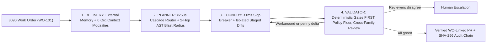

# DEADBOLT

**Deterministic Governance Layer, 2-Hop Blast-Radius Planner, Self-Rejecting Validator, and Live Breaker Panel for the 8090 Software Factory**

AI software factories generate code fast, but generating code is not knowing it is safe to merge. I built **DEADBOLT** at **EVOLVE (8090 AI Hackathon)** to plug directly into 8090's 4-stage Software Factory pipeline (`1. Refinery -> 2. Planner -> 3. Foundry -> 4. Validator`) and reduce the risk of unsafe AI-generated changes through deterministic controls, separate-family model review, and crash-recoverable staged execution.

## Architecture: How DEADBOLT Plugs Into 8090



### Core Capabilities

1. **Stage 1: Refinery (`src/engines/refinery-context.js`, `src/connectors/hydradb-graph.js`)**  
   Hydrates governing engineering invariants (`< 4,000` tokens/turn) outside the LLM context window from all 6 organizational context modalities (8090 Work Orders/Requirements/Blueprints, codebase spans, past failure traces with `supersedes_id` lineage, emails, Slack threads, and meeting transcripts) using SQLite `FTS5/BM25` + `INV-12` SHA-256 code-span drift locks, `Raw-RAG` lossless windows, and **HydraDB Dual-Live** (`API-Version: 2` hybrid thinking + `v0.4.0` OpenCypher `:DEPENDED_ON_BY` / `:SUPERSEDES` graph sync).
2. **Stage 2: Planner & Polyglot Brownfield Scanner (`src/engines/planner-graph.js`)**  
   Maps the 2-hop AST call-graph blast radius (`fee-engine.js -> settlement-service.js -> sox-reconciler.js`) via `krusch-git`, routes bounded plumbing vs. domain math in `< 25µs` via the in-process Cascade Router, computes disjoint AST leases so non-overlapping 8090 Work Orders (`WO-101`, `WO-102`, `WO-103`) can execute in parallel, and scans any pasted GitHub repository URL or local path across **14 languages and 28 deterministic hazard/migration rules** (JavaScript/TypeScript, Python, PHP-to-Next.js, Java, C#, Go, Ruby, Rust, Kotlin, SQL, YAML, Shell, and Docker).
3. **Stage 3: Foundry (`src/engines/foundry-staging.js`)**  
   Enforces pre-audited Golden Bricks with a `< 1ms` zero-token Slop Breaker (`scoreLegoBrickCoverage`), stages unified diffs in per-task isolated workspaces, and records write-ahead apply intent in SQLite with deterministic mid-apply crash recovery (`recoverInFlight`).
4. **Stage 4: Validator & Self-Rejection (`src/engines/validator-gate.js`)**  
   Runs checks in fixed non-overridable order:
   - **Import-Frozen Policy Floor (`INV-DB-05`)**: Catches and rejects DEADBOLT's own supervised agent (`FLOOR-PATH-PROTECTED`) if it attempts a shortcut workaround (such as editing `sox-reconciler.js` or widening cent tolerance) instead of fixing the root rounding bug.
   - **SOX-Style Batch Reconciliation Demonstration (`INV-FIN-03`)**: Computes exact integer-cent batch settlement totals (`expectedNetCents`, `actualNetCents`, and `+1¢` delta).
   - **Separate-Family Review & Disagreement Escalation**: Runs fail-closed cross-family review (`Gemini` + `DeepSeek`) only after deterministic checks pass, escalates reviewer disagreement to a human operator, logs every verdict to a restart-safe HMAC SHA-256 hash-chained audit ledger, and measures real cost per verified task.
5. **Live GitHub Legacy Modernization Benchmark (`src/engines/modernizer-benchmark.js`)**  
   Runs a live head-to-head modernization wave (`POST /api/repo/modernize`) comparing a single frontier model with full-repository context stuffing against **HydraDB 2-hop graph slicing + `< 25µs` Cascade Router + `< 1ms` Golden Brick Slop Breaker + 2-family verification**, writing `:SUPERSEDES` lineage back to HydraDB only when verification succeeds.
6. **3-Tab Live Breaker Panel & 8090-Aligned MCP Server (`client/`, `src/mcp/deadbolt-mcp.js`)**  
   High-contrast dark-obsidian cockpit (`1. Work Order Gate`, `2. GitHub Modernizer`, `3. Safety Drills & MCP`) with split-screen **Standard Agent vs. DEADBOLT** SSE streaming, **ElevenLabs** Factory Foreman breaker alerts (with offline PCM16 WAV synthesis fallback), **Composio** Confused-Deputy gated PR dispatch, and a 5-tool MCP server matching 8090's `4 Allow` (read-only Automations) vs. `1 Confirm` (mutating Action) permission split.

## Quick Start

```bash
cp .env.example .env
npm ci
npm test
npm start
```

*(Optional local HydraDB `v0.4.0` OpenCypher graph engine: `docker compose --profile hydradb up -d`.)*

Open `http://127.0.0.1:4090` to launch the **DEADBOLT Breaker Panel**, or attach the stdio MCP server (`npm run mcp`) to 8090 Software Factory / Cursor / Claude Code / Antigravity. To idempotently seed an 8090 Software Factory project with DEADBOLT's Feature Requirements, Component Blueprint, Governance Skill, `[WO-101..103]` Work Orders, and Stage 4 Feedback signal via `SOFA_API_KEY` (`sofa-ext-*`), run `npm run seed:8090`.

---

## Open Source License & EVOLVE Section 10(c) / Section 11 Disclosures

**License**: Released under the **MIT License** (`Copyright (c) 2026 Kevin Saylor Ruschman`). See [`LICENSE`](./LICENSE).

### 1. What Was Built During the EVOLVE Event Period (Nov 13, 2026 7:10 PM PT to Nov 14, 2026 3:30 PM PT)
- **DEADBOLT Governance Pipeline (`deadbolt`)**: End-to-end 4-stage Software Factory governance orchestrator (`Refinery -> Planner -> Foundry -> Validator`), 6-modality organizational context refinery, HydraDB Dual-Live OpenCypher connector, parallel `WO-*` disjoint AST lease planner, 14-language / 28-rule live GitHub brownfield scanner, head-to-head legacy modernization benchmark (`1 Frontier vs. HydraDB + Cascade`), SOX-style financial batch reconciliation gate (`INV-FIN-03`), self-rejection workaround interceptor, Confused-Deputy & crash-recovery drills, 8090-aligned 5-tool MCP server, 3-tab React Breaker Panel UI, ElevenLabs Factory Foreman voice telemetry, and measured cost-per-verified-task instrumentation.

### 2. Pre-Existing Public Open-Source Libraries by Author (Disclosed per Agreement Section 10(c))
| Package / Repository | License | Pre-Existing Role Used as Library Dependency |
|---|---|---|
| [`@krusch/toolkit`](https://github.com/kruschdev/toolkit) (`v1.8.1`) | MIT | Pre-audited runtime Golden Bricks (`http`, `streaming`, `mcp`, `sqlite`, `security`, `audit-log`, `cascade`, `hydradb`, `audio`, `raw-rag`, `harness-engineering`, `trajectory-guard`, `react`) & `<1ms` `auditBoilerplateText` / `scoreLegoBrickCoverage` Slop-Breaker rules. |
| [`krusch-stack`](https://github.com/kruschdev/krusch-stack) (`v1.1.0`) | MIT | Unified Node 22 SQLite packaging of Tier 1 working memory (`krusch-context-mcp`), Tier 2A AST symbol & dependency graph (`krusch-git`), and Tier 3 staged diff journal (`krusch-coding-harness`). |
| [`krusch-context-mcp`](https://github.com/kruschdev/krusch-context-mcp) (`v2.0.0`) | MIT | Tier 1 SQLite `FTS5/BM25` + `1024d` vector working-memory MCP server with `INV-12` SHA-256 span drift locks. |
| [`krusch-git`](https://github.com/kruschdev/krusch-git) (`v1.2.2`) | MIT | Tier 2A AST symbol & 2-hop call-graph dependency engine. |
| [`krusch-coding-harness`](https://github.com/kruschdev/krusch-coding-harness) | MIT | Tier 3 isolated workspace staging and durable write-ahead apply-intent journal primitives. |
| [`krusch-cascade-router`](https://github.com/kruschdev/krusch-cascade-router) | MIT | In-process `<25µs` L1-L3 task complexity cascade routing and circuit-breaker reference architecture. |

### 3. Sponsor Event Tools, Commercial APIs & Open-Source Dependencies (Agreement Sections 10(c) & 11)
- **8090 Software Factory** (Event Tool, subject to 8090 Event Tool Terms)
- **HydraDB** ([`hydra-db/hydradb`](https://github.com/hydra-db/hydradb) `v0.4.0` OpenCypher Graph Engine & `API-Version: 2`, Elastic License 2.0 `ELv2` / Sponsor Event Tool Terms)
- **Composio** (Composio Connect MCP + REST v3 API via DNS-pinned `safeFetch`, Sponsor Service Terms)
- **ElevenLabs** (ElevenLabs TTS Streaming API, Sponsor Service Terms)
- **OpenRouter** (`anthropic/claude-sonnet-5.5`, `deepseek/deepseek-v3.2`, `deepseek/deepseek-v4.1-flash`, `google/gemini-3.5-flash-lite`) & **Google Gemini API** (`gemini-3.8-flash`)
- **Ollama** *(optional local GPU fast/reviewer tier: `qwen2.5-coder:7b`, `qwen3-coder-30b-moe`)*
- **Vercel** (Deployment & Preview Platform, Sponsor Service Terms)
- **Node.js 22 ESM, SQLite (`node:sqlite` WAL + `FTS5`), React 19 + Vite 6** (MIT)
- **Brownfield Scan & Modernization Targets**: [`taniarascia/pdo`](https://github.com/taniarascia/pdo) (MIT License, Copyright Tania Rascia; reference schema for `pdo-nextjs-governed` Next.js App Router port), [`expressjs/cors`](https://github.com/expressjs/cors) (MIT License), [`kelseyhightower/nocode`](https://github.com/kelseyhightower/nocode) (Apache-2.0 License), and bundled synthetic fixtures (`acme-legacy-billing`, `pdo-nextjs-governed`).
