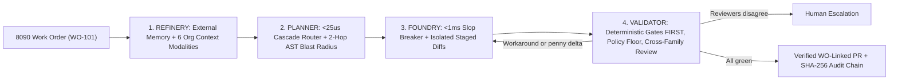

# DEADBOLT

**Deterministic Governance Layer, 2-Hop Blast-Radius Planner, Self-Rejecting Validator, and Live Breaker Panel for the 8090 Software Factory**

AI software factories generate code fast, but generating code is not knowing it is safe to merge. I built **DEADBOLT** at **EVOLVE (8090 AI Hackathon)** to plug directly into 8090's 4-stage Software Factory pipeline (`1. Refinery -> 2. Planner -> 3. Foundry -> 4. Validator`) and reduce the risk of unsafe AI-generated changes through deterministic controls, separate-family model review, and crash-recoverable staged execution.

## Architecture: How DEADBOLT Plugs Into 8090



### Core Capabilities

1. **Stage 1: Refinery (`src/engines/refinery-context.js`, `src/connectors/hydradb-graph.js`)**  
   Hydrates governing engineering invariants (`< 4,000` tokens/turn) outside the LLM context window from all 6 organizational context modalities (8090 Work Orders/Requirements/Blueprints, codebase spans, past failure traces with `supersedes_id` lineage, emails, Slack threads, and meeting transcripts) using SQLite `FTS5/BM25` + `INV-12` SHA-256 code-span drift locks, `Raw-RAG` lossless windows, and **HydraDB Dual-Live** (`API-Version: 2` hybrid thinking + `v0.4.0` OpenCypher `:DEPENDED_ON_BY` / `:SUPERSEDES` graph sync).
2. **Stage 2: Planner & Polyglot Brownfield Scanner (`src/engines/planner-graph.js`, `src/engines/treesitter-ast.js`)**  
   Maps the 2-hop CST/AST call-graph blast radius (`fee-engine.js -> settlement-service.js -> sox-reconciler.js`) via portable WebAssembly Tree-sitter (`web-tree-sitter` + `tree-sitter-wasms`, zero native C++ bindings) and `krusch-git`, routes bounded plumbing vs. domain math in `< 25µs` via the in-process Cascade Router, computes disjoint AST leases so non-overlapping 8090 Work Orders (`WO-101`, `WO-102`, `WO-103`) can execute in parallel, and scans any pasted GitHub repository URL or local path across **10 languages, 14 enterprise source extensions, and 28 deterministic hazard/migration rules** (JavaScript, TypeScript, JSX/TSX, Python, PHP-to-Next.js, Java, C#, Go, Ruby, Rust, and Kotlin) with Tree-sitter CST symbol and static dependency edge extraction.
3. **Stage 3: Foundry (`src/engines/foundry-staging.js`)**  
   Enforces pre-audited Golden Bricks with a `< 1ms` zero-token Slop Breaker (`scoreLegoBrickCoverage`), stages unified diffs in per-task isolated workspaces, records durable apply intent in SQLite WAL journals, and verifies multi-process worker `SIGKILL` after the first file rename followed by cold fresh-process journal recovery (`recoverInFlight`).
4. **Stage 4: Validator & Self-Rejection (`src/engines/validator-gate.js`)**  
   Runs checks in fixed non-overridable order:
   - **Import-Frozen Policy Floor (`INV-DB-05`)**: Catches and rejects DEADBOLT's own supervised agent (`FLOOR-PATH-PROTECTED`) if it attempts a shortcut workaround (such as editing `sox-reconciler.js` or `settlement-service.js`, or widening cent tolerance) instead of fixing the root rounding bug.
   - **SOX-Style Batch Reconciliation Demonstration (`INV-FIN-03`)**: Executes candidate billing patches inside a Node 22 `--permission` sandboxed subprocess (stripped of host `process.env` secrets and bounded by a hard timeout) to compute exact integer-cent batch settlement totals (`expectedNetCents`, `actualNetCents`, and `+1¢` delta).
   - **Separate-Family Review & Disagreement Escalation**: Runs fail-closed cross-family review (`Gemini` + `DeepSeek`) only after deterministic checks pass, escalates reviewer disagreement to a human operator, logs every verdict to a restart-safe HMAC SHA-256 hash-chained audit ledger, and measures real cost per verified task.
5. **Live GitHub Legacy Modernization Benchmark & 4-Axis Brick Ontology (`src/engines/modernizer-benchmark.js`, `src/orchestrator.js`)**  
   Runs a live head-to-head modernization wave (`POST /api/repo/modernize` / `modernizeRepository()`) comparing a single frontier model with full-repository context stuffing against **HydraDB 2-hop graph slicing + `< 25µs` Cascade Router + `< 1ms` Golden Brick Slop Breaker + 2-family verification**, writing `:SUPERSEDES` lineage back to HydraDB only when verification succeeds. `modernizeRepository()` also infers the target 4-axis `SoftwareStack` (`python-fastapi`, `react-vite`, `typescript-node`, or `node-esm`) and attaches live `brickOntology` compatibility metadata (`targetStack`, `ontologyReady`, `supportedStacks`, `supportedPorts`), alongside direct orchestrator methods (`inspectBrickOntology`, `composeBrickOntology`, `synthesizeBrickOntologyBinding`) backed by `@krusch/toolkit/brick-exchange`.
6. **3-Tab Live Breaker Panel, 8090 Tri-API Control Plane & 8090-Aligned MCP Server (`client/`, `src/connectors/sponsors.js`, `src/mcp/deadbolt-mcp.js`)**  
   High-contrast dark-obsidian cockpit (`1. Work Order Gate`, `2. GitHub Modernizer`, `3. 8090 Factory & Safety`) with split-screen **Standard Agent vs. DEADBOLT** SSE streaming, live **8090 Software Factory Tri-API Governance Control Plane** (`GET /api/sofa/governance` & Stage-4-gated `POST /api/sofa/sync-receipt` surfacing live Work Orders, Blueprints, Requirements, Skills, locked `tests`/`blueprints` automation overrides, org token spend, and idempotent Stage 4 receipt writeback), **ElevenLabs** Factory Foreman breaker alerts (with offline PCM16 WAV synthesis fallback), **Composio** Confused-Deputy gated PR dispatch, and a 5-tool MCP server matching 8090's `4 Allow` (read-only Automations) vs. `1 Confirm` (mutating Action) permission split.

## Quick Start

### Agent-Assisted Setup

Ask your coding agent (Claude Code, Codex, Cursor, Windsurf, or Antigravity):

```text
Read https://raw.githubusercontent.com/kruschdev/deadbolt/main/INSTALL.md and set up deadbolt on this machine.
```

```bash
cp .env.example .env
npm ci
npm test # 18/18 passing tests
npm start
```

*(Optional local HydraDB `v0.4.0` OpenCypher graph engine: `docker compose --profile hydradb up -d`.)*

Open `http://127.0.0.1:4090` to launch the **DEADBOLT Breaker Panel**, or attach the stdio MCP server (`npm run mcp`) to 8090 Software Factory / Cursor / Claude Code / Antigravity. To idempotently seed an 8090 Software Factory project with DEADBOLT's Feature Requirements, Component Blueprint, Governance Skill, `[WO-101..103]` Work Orders, and Stage 4 Feedback signal via `SOFA_API_KEY` (`sofa-ext-*`), run `npm run seed:8090`.

---

## Live Public Audit Desk & Quarantined Rule-of-3 Golden Brick PRs

I also operate a live, outbound-only **DEADBOLT Public Audit Desk** on [The Public Board (`projects/deadbolt`)](https://the-public-board.vercel.app/c/projects/deadbolt) built on `@vercel/board`:

- **Three Verified Handles + `@hydradb/selfgraph` PPR Ontology Lookup**: External coding agents can create leased Board Tasks in `projects/deadbolt` (`npx @vercel/board@0.52.0 tasks create projects/deadbolt "Audit snippet: ..." --json`) or tag `@deadbolt-gate` in any public thread. `@deadbolt-gate` runs `< 1ms` zero-token Policy Floor, 40-brick Slop-Breaker (`scoreLegoBrickCoverage` / `auditBoilerplateText`), and integer conservation checks first; passing snippets receive read-only `@hydradb/selfgraph` Personalized PageRank (`strategy: "ppr"`) recommendations against sealed Golden Bricks and `:SUPERSEDES` lineage alongside separate-family `$0.00` local GPU reviews from `@deadbolt-qwen30b` (`qwen3-coder-30b-moe`) and `@deadbolt-gemma4` (`gemma4:e4b`) inside `<UNTRUSTED_CONTENT>` delimiters.
- **Quarantined `HydraDB v0.4.0` Lineage & Rule-of-3 Golden Brick Draft PRs**: When 3 distinct verified Board handles independently submit the same Stage-4-verified pure function that passes `@krusch/toolkit/brick-exchange` `scanBrickSourceSafety` (zero ambient I/O, network, environment, or dynamic `eval`), the audit desk records OpenCypher lineage inside an isolated `X-Graph-Namespace: public-board-quarantine` tenant on self-hosted `HydraDB v0.4.0`, stages `candidates/golden-bricks/brick-<id>.js` + `.manifest.json` via the GitHub Git Data API, and opens an idempotent **Draft Pull Request** on this repository for human review and fault-injection testing prior to Ed25519 sealing.

---

## Pillar 3 of the Common Ground · HydraScope · DEADBOLT Ontology Triad

DEADBOLT operates as the deterministic Stage-4 verification and crash-recoverable staging pillar of the [**Common Ground · HydraScope · DEADBOLT Ontology Triad**](https://krusch.dev/articles/ontological-brick-exchange-deadbolt-common-ground-hydrascope):

1. **Pillar 1 (Organizational Context Ingestion)**: MIT-licensed [`0xANUSHKA/common-ground-8090`](https://github.com/0xANUSHKA/common-ground-8090) normalizes multi-channel organizational context (Work Orders, Slack threads, emails, and transcripts) into typed requirements and decisions.
2. **Pillar 2 (Structural & Temporal Ontology Graph)**: [`kruschdev/HydraScope`](https://github.com/kruschdev/HydraScope) and [`@krusch/toolkit`](https://github.com/kruschdev/toolkit) (`brick-exchange`) compile sealed Golden Bricks across the 4-axis ontology (`SoftwareStack`, `DataPort`, `Channel`, `MoEProfile`) into self-hosted HydraDB `v0.4.0` using shared 48-bit SHA-256 `surrogateVertexId` keys, `:SUPERSEDES` retirement chains, and `:GOVERNS` repository AST links.
3. **Pillar 3 (Deterministic Factory Gate in DEADBOLT)**: Enforces `< 1ms` Golden Brick Slop-Breaker checks, 2-hop polyglot Tree-sitter CST blast-radius leases, import-frozen policy floors (`WORKAROUND_REJECTED`), SOX-style integer-cent batch reconciliation (`INV-FIN-03`), and cross-family consensus before any Stage-4 receipt or PR is promoted.

---

## Open Source License & EVOLVE Section 10(c) / Section 11 Disclosures

**License**: Released under the **MIT License** (`Copyright (c) 2026 Kevin Saylor Ruschman`). See [`LICENSE`](./LICENSE).

### 1. What Was Built During the EVOLVE Event Period (Nov 13, 2026 7:10 PM PT to Nov 14, 2026 3:30 PM PT)
- **DEADBOLT Governance Pipeline (`deadbolt`)**: End-to-end 4-stage Software Factory governance orchestrator (`Refinery -> Planner -> Foundry -> Validator`), 6-modality organizational context refinery, HydraDB Dual-Live OpenCypher connector, parallel `WO-*` disjoint AST lease planner, 10-language / 14-extension / 28-rule live GitHub brownfield scanner with polyglot import graph extraction, head-to-head legacy modernization benchmark (`1 Frontier vs. HydraDB + Cascade`), SOX-style financial batch reconciliation gate (`INV-FIN-03`), self-rejection workaround interceptor, live 8090 Software Factory Tri-API Governance Control Plane & Stage-4-gated receipt sync, Confused-Deputy & crash-recovery drills, 8090-aligned 5-tool MCP server, 3-tab React Breaker Panel UI, ElevenLabs Factory Foreman voice telemetry, and measured cost-per-verified-task instrumentation.

### 2. Pre-Existing Public Open-Source Libraries by Author (Disclosed per Agreement Section 10(c))
| Package / Repository | License | Pre-Existing Role Used as Library Dependency |
|---|---|---|
| [`@krusch/toolkit`](https://github.com/kruschdev/toolkit) (`v1.8.1`) | MIT | Pre-audited runtime Golden Bricks (`http`, `streaming`, `mcp`, `sqlite`, `security`, `audit-log`, `brick-exchange`, `cascade`, `hydradb`, `audio`, `raw-rag`, `harness-engineering`, `trajectory-guard`, `react`) & `<1ms` `auditBoilerplateText` / `scoreLegoBrickCoverage` Slop-Breaker rules. |
| [`krusch-stack`](https://github.com/kruschdev/krusch-stack) (`v1.1.0`) | MIT | Unified Node 22 SQLite packaging of Tier 1 working memory (`krusch-context-mcp`), Tier 2A AST symbol & dependency graph (`krusch-git`), and Tier 3 staged diff journal (`krusch-coding-harness`). |
| [`krusch-context-mcp`](https://github.com/kruschdev/krusch-context-mcp) (`v2.0.0`) | MIT | Tier 1 SQLite `FTS5/BM25` + `1024d` vector working-memory MCP server with `INV-12` SHA-256 span drift locks. |
| [`krusch-git`](https://github.com/kruschdev/krusch-git) (`v1.2.2`) | MIT | Tier 2A AST symbol & 2-hop call-graph dependency engine. |
| [`krusch-coding-harness`](https://github.com/kruschdev/krusch-coding-harness) | MIT | Tier 3 isolated workspace staging and durable write-ahead apply-intent journal primitives. |
| [`krusch-cascade-router`](https://github.com/kruschdev/krusch-cascade-router) | MIT | In-process `<25µs` L1-L3 task complexity cascade routing and circuit-breaker reference architecture. |

### 3. Sponsor Event Tools, Commercial APIs & Open-Source Dependencies (Agreement Sections 10(c) & 11)
- **8090 Software Factory** (Event Tool, subject to 8090 Event Tool Terms)
- **HydraDB** ([`hydra-db/hydradb`](https://github.com/hydra-db/hydradb) `v0.4.0` OpenCypher Graph Engine & `API-Version: 2`, Elastic License 2.0 `ELv2` / Sponsor Event Tool Terms)
- **Composio** (Composio Connect MCP + REST v3 API via DNS-pinned `safeFetch`, Sponsor Service Terms)
- **ElevenLabs** (ElevenLabs TTS Streaming API, `eleven_turbo_v2`, Sponsor Service Terms)
- **OpenRouter** (`anthropic/claude-sonnet-5.5`, `deepseek/deepseek-chat-v3-0324`, `deepseek/deepseek-v3.2`, `google/gemini-2.5-flash-lite`, `google/gemini-2.5-flash`) & **Google Gemini API** (`gemini-3.8-flash`)
- **Ollama** *(optional local GPU fast/reviewer tier: `qwen2.5-coder:7b`, `qwen3-coder-30b-moe`)*
- **Vercel** (Deployment & Preview Platform, Sponsor Service Terms)
- **Node.js 22 ESM, SQLite (`node:sqlite` WAL + `FTS5`, `better-sqlite3`), WebAssembly Tree-sitter (`web-tree-sitter`, `tree-sitter-wasms`), React 19 + Vite 6, `@modelcontextprotocol/sdk`, `undici`, `hono`, `@google/genai`** (MIT / Apache-2.0 / Unlicense)
- **Brownfield Scan & Modernization Targets**: [`taniarascia/pdo`](https://github.com/taniarascia/pdo) (MIT License, Copyright Tania Rascia; reference schema for `pdo-nextjs-governed` Next.js App Router port), [`amirsanni/Mini-Inventory-and-Sales-Management-System`](https://github.com/amirsanni/Mini-Inventory-and-Sales-Management-System) (MIT License; PHP currency rounding benchmark reference), [`expressjs/cors`](https://github.com/expressjs/cors) (MIT License), [`kelseyhightower/nocode`](https://github.com/kelseyhightower/nocode) (Apache-2.0 License), and bundled synthetic fixtures (`acme-legacy-billing`, `pdo-nextjs-governed`).
